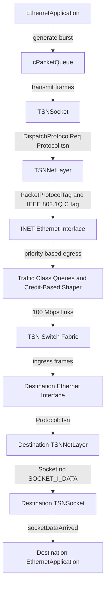
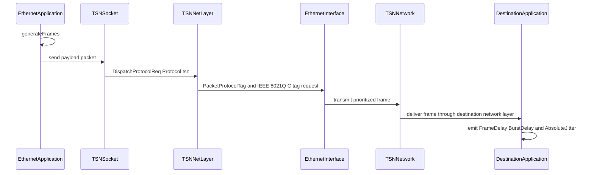

# IEEE 802.1Q Automotive Ethernet Simulation

A discrete-event simulation of an automotive Ethernet network built with
[OMNeT++](https://omnetpp.org) and [INET](https://inet.omnetpp.org). The
project models VLAN-tagged traffic streams with IEEE 802.1Q priority code
points, per-class egress queues, and Credit-Based Shaper (CBS) transmission
selection. It provides a custom TSN network layer and a flow-aware socket
abstraction on top of INET, together with delay and jitter statistics for every
traffic stream.

The simulation reproduces a representative in-vehicle topology with 18 TSN end
devices and 2 TSN switches connected through 100 Mbps links.

## Key Features

- Periodic burst generation with configurable payload, period, MTU, and
  inter-arrival time.
- VLAN identifier and IEEE 802.1Q priority code point tagging for every frame.
- Flow-based socket binding and packet demultiplexing.
- Custom `TSNNetLayer` implementing the INET `INetworkLayer` contract.
- IEEE 802.1Q C-tag encapsulation requests handled by the INET link layer.
- Eight traffic classes and Credit-Based Shaper configuration on the simulated
  data paths.
- Per-frame delay, burst completion delay, and absolute jitter statistics.
- Ready-to-run OMNeT++ topology and configuration for the complete network.

The accompanying technical report is available in
[IEEE802.1Q_Application&Simulation.pdf](<IEEE802.1Q_Application&Simulation.pdf>).

## System Architecture

The simulation is organized as a standard OMNeT++ project. The application
layer produces traffic, the custom network layer dispatches it, and the INET
link and TSN layers provide VLAN-aware queuing and shaping.

The implementation follows INET's interface-driven architecture: the
application implements `IApp`, the network layer implements `INetworkLayer`,
and the socket extends `SocketBase`. `TSNNetLayer` applies a dispatcher pattern
to route messages between protocol layers, while `TSNSocket` uses an
observer-style callback to notify the application of socket events.

### Modules

| Module | Responsibility |
| --- | --- |
| `EthernetApplication` | Generates bursts of frames, transmits them through a TSN socket, and records end-to-end statistics for received frames. |
| `TSNSocket` | Extends the INET `SocketBase` with flow-name binding and TSN protocol dispatching. |
| `TSNNetLayer` | Implements the INET `INetworkLayer` contract and dispatches packets between the transport and link layers. |
| `EthernetDataPayload` | Carries the frame index, burst size, and generation time used for delay statistics. |
| `TSNBindCommand` | Carries the flow name in socket bind requests. |
| `TestNet` | Defines the automotive network topology with TSN devices, TSN switches, and 100 Mbps links. |

### Data Path



### Execution Pipeline



### Repository Layout

```text
IEEE-802.1Q-Application/
├── README.md
├── IEEE802.1Q_Application&Simulation.pdf   # Technical report
└── Elaborato2024/
    ├── Makefile                            # Top-level build wrapper
    ├── makemakefiles                       # OMNeT++ makefile helper
    ├── out/                                # Generated build artifacts
    ├── src/
    │   ├── Makefile                        # Generated by opp_makemake
    │   ├── package.ned
    │   └── application/
    │       ├── EthernetApplication.h       # Application module interface
    │       ├── EthernetApplication.cc      # Burst generation and statistics
    │       ├── EthernetApplication.ned     # Application module declaration
    │       ├── TSNNetLayer.h               # Network layer interface
    │       ├── TSNNetLayer.cc              # Protocol registration and dispatch
    │       ├── TSNNetLayer.ned             # Network layer module declaration
    │       ├── TSNSocket.h                 # Flow-aware socket interface
    │       ├── TSNSocket.cc                # Socket implementation
    │       ├── EthernetDataFrames.msg      # Payload and bind command definitions
    │       ├── EthernetDataFrames_m.h      # Generated message header
    │       └── EthernetDataFrames_m.cc     # Generated message implementation
    └── simulations/
        ├── omnetpp.ini                     # Network and traffic configuration
        ├── TestNet.ned                     # Automotive topology
        ├── package.ned
        ├── run                             # Convenience launch script
        ├── General.anf                     # Analysis configuration
        └── results/                        # Simulation result files
```

The `*_m.h` and `*_m.cc` files are generated from
`src/application/EthernetDataFrames.msg` by `opp_msgtool` and must not be
edited manually.

## Prerequisites

- OMNeT++ 6.0.x. The project was generated with OMNeT++ 6.0.3.
- INET 4.5.x, built for the same OMNeT++ installation.
- A C++17-capable compiler and GNU Make.
- Qt 5 or Qt 6 if the Qtenv graphical runtime is required. Cmdenv alone does
  not require Qt.

### Environment Setup

Source the OMNeT++ environment and build INET:

```bash
source /path/to/omnetpp-6.0.3/setenv

export INET_ROOT="/path/to/omnetpp-6.0.3/samples/inet4.5"
cd "$INET_ROOT"
make makefiles
make -j4 MODE=release
```

## Installation

The checked-in `src/Makefile` was generated on a different machine and
contains a hard-coded INET path. Regenerate it before building:

```bash
cd Elaborato2024/src

opp_makemake -f --deep \
  -KINET4_5_PROJ="$INET_ROOT" \
  -DINET_IMPORT \
  -I'$(INET4_5_PROJ)/src' \
  -L'$(INET4_5_PROJ)/src' \
  -l'INET$(D)'

cd ..
make -j4 MODE=release
```

The build creates the `Elaborato2024` executable in `src/` and stores object
files under `out/`.

## Configuration

Runtime configuration is contained in
`Elaborato2024/simulations/omnetpp.ini`. No environment file or external
service is required. The `INET_ROOT` variable is only used during makefile
generation.

### Network Selection

```ini
[General]
network = TestNet
**.app[*].typename = "EthernetApplication"
```

The custom network layer is enabled for every node by the following options:

```ini
**.hasGn = true
**.generic.typename = "TSNNetLayer"
```

### Application Parameters

| Parameter | Unit | Description |
| --- | --- | --- |
| `startTime` | s | Time at which frame generation begins. A negative value disables generation. |
| `period` | s | Interval between consecutive burst generations. |
| `deadlineRel` | s | Relative deadline of the traffic stream. |
| `payload` | B | Total payload size of a burst. |
| `mtu` | B | Maximum payload size of a single frame. The burst is split into `ceil(payload / mtu)` frames. |
| `interarrivalTime` | s | Delay between consecutive frames of the same burst. A value of zero transmits the burst back to back. |
| `priority` | - | IEEE 802.1Q priority code point. The configuration uses 7 for SR A, 6 for SR B, and 5 for best effort. |
| `vlanid` | - | VLAN identifier applied to generated frames. The default value is 0. |
| `name` | - | Flow name used for socket binding and ingress packet matching. |
| `localAddress` | - | Local MAC address or a resolvable module name. |
| `remoteAddress` | - | Destination MAC address or a resolvable module name. |
| `netInterface` | - | Egress network interface name. |
| `interfaceTableModule` | - | Path to the interface table module. |

The current scenario defines 17 streams across the `LD`, `US`, `ME`, `CM1`,
`CU`, `TLM`, and `RC` nodes. Each source is configured with the same flow name
at the sender and at the receiver so that `TSNNetLayer` can route frames to the
matching socket.

### Traffic Classes and Shaping

- Eight traffic classes are configured on the simulated data paths.
- Classes 6 and 7 use `Ieee8021qCreditBasedShaper`.
- `idleSlope` values are configured per egress port and traffic class.
- Egress traffic shaping is enabled on switches and end devices.

## Usage

Run the default configuration with the command-line runtime:

```bash
cd Elaborato2024/simulations

../src/Elaborato2024 -u Cmdenv -n .:../src omnetpp.ini
```

Run the graphical runtime:

```bash
../src/Elaborato2024 -u Qtenv -n .:../src omnetpp.ini
```

The `run` convenience script performs the same launch using the executable name
stored in the script:

```bash
./run -u Cmdenv
```

The script references the executable as `../src/elaborato2024`. On
case-sensitive file systems, use the direct `../src/Elaborato2024` invocation
shown above.

### Overriding Parameters

Any configuration option can be overridden on the command line:

```bash
../src/Elaborato2024 -u Cmdenv -n .:../src \
  '--**.LD1.app[*].payload=2600B'
```

For persistent changes, edit the corresponding parameter in
`simulations/omnetpp.ini` and rerun the simulation.

### Results and Statistics

Scalar and vector results are written to `simulations/results/`. The
application emits the following signals:

| Signal | Emitted for | Description |
| --- | --- | --- |
| `FrameDelay` | Every received frame | End-to-end delay of a single frame. |
| `BurstDelay` | Last frame of each burst | Delay observed when the burst completes. |
| `AbsoluteJitter` | Every received frame | Difference between the maximum and minimum frame delays observed so far. |

The `General.anf` file provides a ready-made analysis configuration for the
OMNeT++ IDE Analysis Tool.

### Validating the Configuration

No automated test suite is included. A simulation run is considered successful
when:

1. The executable starts without missing NED, module, or parameter errors.
2. Frames are received by the configured destination applications.
3. `FrameDelay`, `BurstDelay`, and `AbsoluteJitter` vectors contain samples.

### Reusing the Modules

The application, socket, and network layer modules can be reused in another
OMNeT++ project by copying `src/application` and importing the corresponding
NED declarations. The receiving application must bind a socket to the same flow
name used by the sender, and the custom network layer must be selected through
`hasGn` and `generic.typename` as shown in the configuration above.

## License

The NED package declares the LGPL license. Refer to the source files for the
applicable licensing terms.
